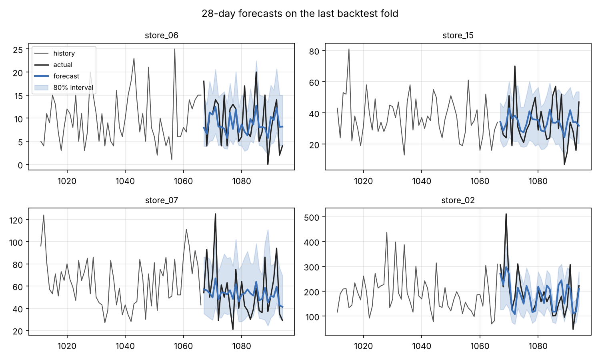
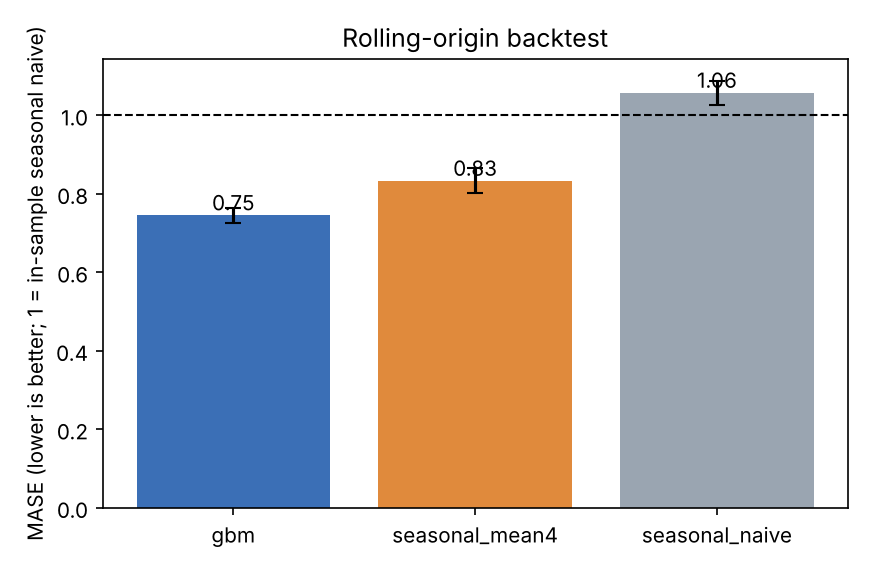

# demandcast

[](https://github.com/YOUR_USERNAME/demandcast/actions)


**Demand forecasting** for multi-store retail: a single global gradient-boosting model with
recursive 28-day forecasts and **conformally calibrated prediction intervals**, benchmarked against
seasonal baselines with a proper **rolling-origin backtest**.

It runs fully offline: a seeded generator creates realistic daily demand (trend, weekly and yearly
seasonality, promotions, holidays, overdispersed count noise), so results are reproducible and the
pipeline can be verified against known structure.

## Results

20 series, 3 years of daily data, 28-day horizon. Rolling-origin backtest with 6 non-overlapping folds:
the 2 oldest calibrate the prediction intervals, the 4 newest are evaluated (mean ± std over the 4 folds).
Each fold's model is trained only on data before its origin.

| Model | MASE | WAPE | MAE (units/day) | Bias |
|---|---|---|---|---|
| **GBM** (global, recursive) | **0.745 ± 0.020** | **24.5%** | **16.6** | -5.2% |
| Seasonal mean (last 4 weeks) | 0.833 ± 0.031 | 27.7% | 18.8 | -3.0% |
| Seasonal naive (last week) | 1.057 ± 0.031 | 34.4% | 23.3 | +0.2% |

MASE below 1 beats the in-sample seasonal-naive forecast. Demand here is noisy count data, so a large
share of the error is irreducible; the GBM still cuts error by about 30% versus seasonal naive.

**80% prediction intervals** (evaluated folds):

| | Coverage | Width / mean demand |
|---|---|---|
| Raw quantile heads | 76.0% | 0.72 |
| After conformal calibration (CQR) | **81.6%** | 0.83 |

Recursive forecasting ignores the uncertainty of its own earlier predictions, so raw quantile heads are
over-confident; calibration on held-out earlier folds fixes that with a small widening.

<p align="center">
  
  
</p>

## How it works

- **One global model, many series.** All series share one `HistGradientBoostingRegressor` per quantile
  (10 / 50 / 90 %), with series id as a categorical feature. This borrows strength across short or noisy series.
- **Features** (`features.py`): lags 1/7/14/28, rolling mean/std, same-weekday mean, calendar and
  holiday flags, and the *planned* promo calendar (known in advance). The same function is used for training and
  recursive inference, so there is no train/serve skew; a test proves features never read the future.
- **Recursive multi-step forecasting:** the median prediction is fed back as the next day's lag.
- **Log1p target:** stabilises variance; quantiles are preserved under the monotone transform.
- **Conformalised quantile regression** (Romano et al., 2019), calibrated per week of horizon.
- **Metrics:** MASE, WAPE, MAE, RMSE, sMAPE, bias, interval coverage and width.

## Quick start

```bash
git clone https://github.com/YOUR_USERNAME/demandcast.git && cd demandcast
python -m venv .venv && source .venv/bin/activate
pip install -e ".[api,dev]"

demandcast train                      # ~40 s: backtest, calibrate, fit, write ./artifacts
demandcast forecast store_03 -H 14    # forecast with 80% interval
demandcast serve                      # http://127.0.0.1:8000/docs
```

```bash
curl "localhost:8000/forecast/store_03?horizon=7"
curl "localhost:8000/series"
```

Docker: `docker build -t demandcast . && docker run --rm -p 8000:8000 demandcast`

## Project layout

```
src/demandcast/
  data.py      synthetic demand generator, calendar
  features.py  single feature function (train == inference)
  models.py    SeasonalNaive, SeasonalMean, GBMForecaster
  evaluate.py  metrics, conformal calibration
  train.py     rolling-origin backtest, final fit
  service.py   forecasting service   api.py FastAPI   cli.py `demandcast`
configs/default.yaml   tests/   Dockerfile   Makefile   .github/workflows/ci.yml
```

## Using your own data

Replace `generate_dataset()` with a loader returning a `Dataset` (a `series x days` demand matrix, a
promo plan including the next 28 days, and dates). Everything downstream is unchanged.

## Limitations

- The data is synthetic; absolute numbers say little about your business. The method and checks transfer.
- Future promo plans must be supplied. The service uses the stored plan for the next 28 days.
- Recursive forecasting accumulates error at longer horizons (see `docs/img/error_by_horizon.png`).
- Conformal calibration assumes the recent past is representative of the near future; re-calibrate regularly.
- Model hyper-parameters are fixed in the config, not tuned.

## License

MIT
